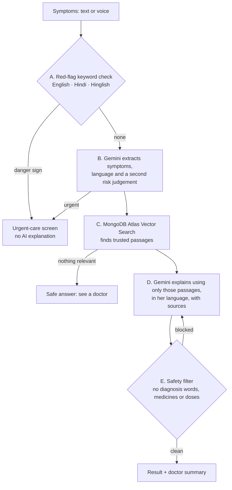

# Ova Care

**A multilingual, safety-first guide to menstrual and hormonal health symptoms.**

Ova Care lets a woman describe her symptoms in her own words — typed or spoken, in English, Hindi, or a mix like Hinglish ("3 mahine se periods nahi aaye, face pe acne") — and explains them in plain language, in her language. It checks for danger signs first, answers only from trusted medical sources, tells her what kind of doctor to see and how soon, and prepares a one-page summary she can show that doctor.

**Live app:** https://ova-care-7sx7.vercel.app

> Ova Care gives general information, not a diagnosis. Please see a doctor for advice about your health.

Built for the **CHAOS Hackathon 2026** (Challenge 3: Women's Health — Understanding Symptoms, with a focus on PCOS).

---

## Why

Many women in India live with irregular periods, acne, weight gain or excess hair growth for years without knowing these can be linked to PCOS. Most information online is in English, full of jargon, or frightening, and many people describe their symptoms in Hindi, a regional language or Hinglish.

## Features

- **Speak or type, in your language** — English, Hindi (Devanagari) and Hinglish; answers come back in the same language and script.
- **Danger signs first** — very heavy bleeding, fainting, sudden severe pain, fever with pelvic pain, pregnancy with pain or bleeding, bleeding after menopause and thoughts of self-harm go straight to an urgent-care screen with helplines (112, 108, Tele-MANAS 14416).
- **Grounded, cited answers** — explanations use only passages retrieved from a curated knowledge base (WHO, NHS, ACOG, CDC, the 2023 international PCOS guideline) and list their sources.
- **Who to see and when** — gynaecologist, general doctor or endocrinologist, with a time frame.
- **Doctor-visit summary** — a printable page in English and in her language, with questions to ask.
- **Chat, education library, period tracker and saved reports** — reports and cycle data are kept only in the browser session and cleared when the tab is closed.

## How it stays safe

Every request goes through the same five steps, and the safety check comes first:



- It never says "you have…", never diagnoses, and never names medicines or doses — a filter checks every answer and asks for a rewrite (naming the exact words to avoid) before anything is shown.
- If no trusted passage is relevant, it does not guess: it recommends seeing a doctor.
- No login, no names, no exact location. Nothing is stored on the server.

## Tech stack

| Layer | Tools |
| --- | --- |
| App | Next.js 16 (App Router), React 19, TypeScript, Tailwind CSS 4, Motion |
| AI | Google Gemini (`@google/genai`): structured JSON output, audio transcription, embeddings (`gemini-embedding-2`, 768 dimensions) |
| Data | MongoDB Atlas with Atlas Vector Search |
| Hosting | Vercel |

## Project structure

```
app/
  page.tsx, layout.tsx      Entry point that mounts the frontend
  api/
    analyze/                Core pipeline endpoint (lib/types.ts contract)
    analyze-symptoms/       Frontend endpoints — all run the same pipeline
    chat/  transcribe/  summary/  health-check/
frontend/                   React UI: screens, i18n, period tracker, education library
lib/
  ai/
    pipeline.ts             The five-step flow above
    redFlags.ts             Step A: keyword red-flag check
    extract.ts  explain.ts  Steps B and D (prompts in lib/ai/prompts/)
    safety.ts               Step E: banned-content filter
    gemini.ts               Gemini client with timeout and model fallback
    embeddings.ts           Query and document embeddings
    summary.ts              Doctor-visit summary
    demo/                   Saved answers for fixed demo inputs
  db/
    client.ts  retrieve.ts  MongoDB connection and vector search
  types.ts                  API contract
content/
  knowledge/                Curated knowledge base (8 topics, with sources)
  red-flags.json            Danger-sign phrases (English, Hindi, Hinglish)
  sources.md  privacy.md
scripts/                    ingest, retrieve:test, demo:warm
tests/cases.csv             50 evaluation cases (typical, urgent, vague, mixed-language, tricky)
```

## Getting started

Requirements: Node.js 20+, a [Google AI Studio](https://aistudio.google.com/apikey) API key, and a MongoDB Atlas cluster (the free M0 tier works).

```bash
npm install
cp .env.example .env.local   # then fill in the values
npm run ingest               # load the knowledge base and build the vector index
npm run dev                  # http://localhost:3000
```

### Environment variables

| Name | Purpose |
| --- | --- |
| `GEMINI_API_KEY` | Google AI Studio key |
| `GEMINI_MODEL` | Main model (default `gemini-3.1-flash-lite`) |
| `GEMINI_FALLBACK_MODEL` | Used when the main model is rate-limited or slow |
| `MONGODB_URI` | MongoDB Atlas connection string |
| `MONGODB_DB` | Database name (default `ovacare`) |

### Scripts

| Command | What it does |
| --- | --- |
| `npm run dev` / `build` / `start` | Run, build or serve the app |
| `npm run lint` | ESLint |
| `npm run ingest` | Chunk, embed and load `content/knowledge/` into MongoDB; create the vector index (`--dry-run` to preview) |
| `npm run retrieve:test` | Try vector searches against the knowledge base |
| `npm run demo:warm` | Save real answers for the demo inputs so the demo never waits on the API |

## API

| Endpoint | Purpose |
| --- | --- |
| `POST /api/analyze` | `{ text, audioBase64?, audioMimeType?, language }` → urgency, explanation, care recommendation, sources (see `lib/types.ts`) |
| `POST /api/summary` | `{ analysis }` → doctor-visit summary in English and her language |
| `POST /api/analyze-symptoms`, `/api/chat`, `/api/transcribe` | Endpoints used by the UI; all go through the same pipeline |
| `GET /api/health-check` | Service status |

All endpoints answer within 20 seconds or return a friendly error, and fall back to a second Gemini model when the first is overloaded.

## How we use MongoDB

- **Atlas Vector Search** over `ovacare.knowledge_chunks`: each knowledge file is split into 150–300-word chunks, embedded with Gemini (768 dimensions, cosine similarity) and stored with its title, topic, language and sources.
- Retrieval returns the top passages above a relevance cut-off, so unrelated questions get a safe "see a doctor" answer instead of a loosely related source.
- `npm run ingest` is idempotent: it replaces each file's chunks and creates the vector index if it does not exist.

## Sources

The knowledge base draws on the World Health Organization, the NHS, the American College of Obstetricians and Gynecologists, the US CDC, Ireland's HSE, the American Society for Reproductive Medicine and the 2023 International Evidence-based Guideline for PCOS. The full list is in [`content/sources.md`](content/sources.md).

## Team

Built by **CA Studio** for the CHAOS Hackathon 2026.

## License

[Apache 2.0](LICENSE)
